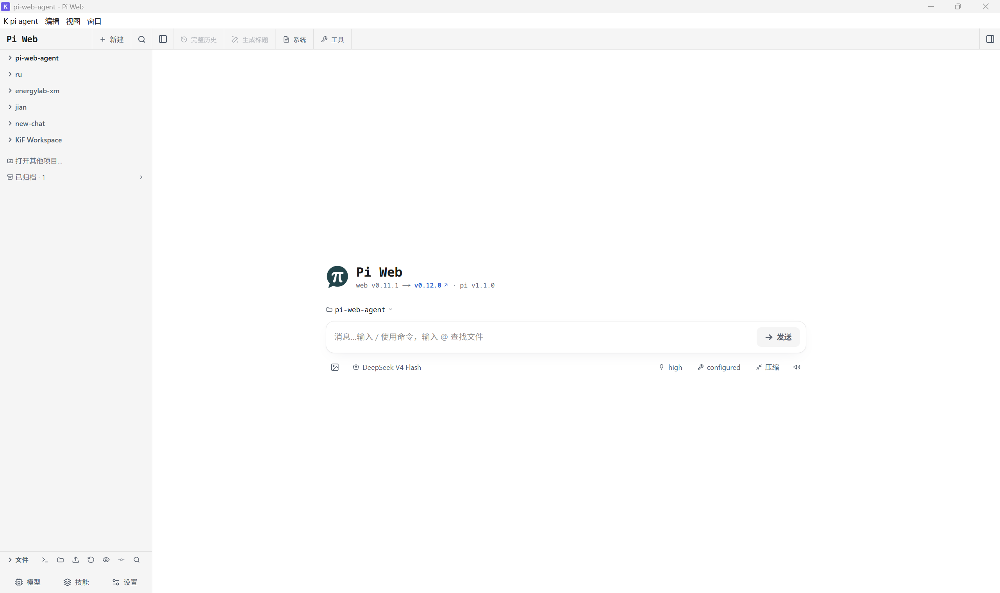
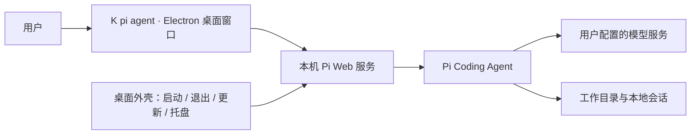

  

<h1 align="center">K pi agent</h1>

面向科研、学习与日常工作的个人电脑助手。 让研究生和非编程用户，更方便地拥有自己的 Agent App。

  
  
  
  
  

  <a href="https://github.com/Deky0827/pi-web-agent-app/releases/download/v2.6.2/K.pi.agent-Setup-2.6.2-x64.exe"><strong>下载 Windows 安装包</strong></a> ·
  <a href="#快速开始">快速开始</a> ·
  <a href="README.zh-CN.md">开发与技术说明</a> ·
  <a href="https://github.com/agegr/pi-web">上游 Pi Web</a> ·
  <a href="README.en.md">English</a>

**K pi agent 致力于成为面向科研、学习与日常工作的个人电脑助手。** 你可以选择自己的模型，围绕自己的工作目录开展任务，并管理本地会话，逐步建立适合自己的 AI 工作方式。

本项目基于 [Pi Web](https://github.com/agegr/pi-web) 构建 Windows 桌面应用，将 Pi Web 与所需的 Node.js 运行环境封装进安装包，减少安装、配置和服务启动的门槛。Agent 界面与会话能力来自上游 Pi Web；本项目提供桌面窗口、托盘、服务运行管理和个性化设置。

这是一个独立的社区项目，不代表 Pi Web 官方发行版。当前发布为 **2.6.2 公开预览版**，欢迎试用和反馈。

## 为什么做这个项目

我不是编程专业人员，也是一名编程小白。最初的想法，是为研究生以及其他非编程专业的用户，搭建一个属于自己的电脑桌面助手，帮助处理科研、学习和日常工作中的实际问题。

调研信息、搜索资料、获取文献、分析数据、制作 PPT，以及排查和修复电脑问题，常常分散在不同的软件与操作流程中。我希望能用自然语言描述任务，让助手围绕自己的文件、资料和工作环境协助完成这些事情，减少反复查教程、配环境和摸索操作的时间。

在使用了一段时间 Pi Web 后，我发现它为这个想法提供了很好的基础。但初次安装、环境配置和本地服务管理，对新手仍有门槛。因此，我将它包装成 Windows 桌面应用，让用户可以先安装、打开，再配置自己的模型服务，逐步建立自己的个人助手。

**长期目标是一个覆盖多种需求的个人电脑助手；当前先把易于安装、启动和使用的桌面基础做好，再持续完善具体任务能力。**

## 希望帮助你做什么

| 场景 | 建设方向 |
| --- | --- |
| 信息调研与搜索 | 查找资料、对比信息，整理来源与调研结果 |
| 文献获取与整理 | 查找论文，下载有权访问的全文，整理文献与阅读材料 |
| 数据分析 | 处理表格和实验数据，辅助分析、绘图与结果整理 |
| PPT 与办公材料 | 整理汇报思路，辅助制作演示文稿和文档 |
| 电脑问题排查与修复 | 分析报错、检查配置，辅助解决软件、依赖和运行环境问题 |

以上是项目希望逐步完善的使用场景，**并不表示当前版本已经内置并验证了全部专用工具或流程**。实际任务能力取决于所配置的模型、工具、技能和访问权限。电脑修复是重点建设方向；涉及系统修改时，目标是让用户理解修改内容，并为重要操作提供确认与恢复办法。

> ⭐ **感谢上游 Pi Web**
>
> 这个应用建立在 Pi Web 的工作之上。感谢 [agegr](https://github.com/agegr) 及上游贡献者提供的 Agent 界面和会话能力。
>
> 如果这个应用对你有帮助，也请为 **[Pi Web 点一颗 Star ⭐](https://github.com/agegr/pi-web)**，支持原作者的工作！

## 下载

| 平台 | 当前版本 | 下载 |
| --- | --- | --- |
| Windows x64 | 2.6.2 · 公开预览版 | [下载安装包](https://github.com/Deky0827/pi-web-agent-app/releases/download/v2.6.2/K.pi.agent-Setup-2.6.2-x64.exe) |

[查看完整发布说明与校验文件](https://github.com/Deky0827/pi-web-agent-app/releases/tag/v2.6.2)。普通用户下载安装包即可；GitHub 自动提供的 Source code 是开发用源码归档。

安装包包含运行环境，无需预先手动安装 Node.js。首次使用仍需配置自己的模型服务、API Key 或提供商登录；API 调用费用由所使用的服务决定。当前未提供 macOS 或 Linux 安装包。

## 快速开始

1. 下载 Windows 安装包，按安装向导完成安装。
2. 从桌面快捷方式或开始菜单打开 **K pi agent**，等待本地服务启动。
3. 在 Pi Web 的模型配置界面添加自己的服务配置或登录支持的提供商。已有 Pi 配置会继续由 Pi 管理。
4. 选择工作目录、模型并开始会话。Agent 可能读写所选目录中的文件，请先用一个便于试用的文件夹熟悉操作。

安装包带有离线运行种子，方便启动本地界面；使用在线模型、检查更新或下载新资源时仍需要网络。

## 当前版本提供的基础能力

| 能力 | 来源与作用 |
| --- | --- |
| Agent 聊天与会话管理 | 由 Pi Web 提供，复用 Pi 的本地配置和会话 |
| 模型与服务配置 | 在 Pi Web 界面内配置自己的模型服务 |
| 桌面窗口与托盘 | 由本项目提供，以桌面应用方式启动和管理 Pi Web |
| 内置运行环境 | 安装包包含 Pi Web 和 Node.js 种子，减少手工环境配置 |
| 本地服务运行管理 | 等待服务启动，退出时停止服务树，意外退出后提供恢复入口 |
| Pi Web 与 Node 更新 | 候选版本先做健康检查，失败时回退；这是运行组件更新，不是桌面安装包自动更新 |
| 外观与桌宠 | 支持主题、界面缩放、自定义 CSS 和桌宠资源；桌宠状态来自本地会话扫描 |

Pi Web 的功能会随内置或更新后的版本变化。当前安装包的种子版本为 **Pi Web 0.11.0**。

## 软件主页预览

  

这是作者提供的实际软件主页截图，展示 Windows 桌面窗口与内嵌的 Pi Web 界面。截图中的模型和项目为个人配置示例，不代表安装包预置内容；运行组件更新后，界面版本可能与安装包种子版本不同。

## 它是怎么工作的

本项目沿用 Pi Web 的界面和服务，通过 Electron 显示本机 `127.0.0.1` 页面。桌面外壳负责运行环境、窗口和桌面集成；Pi Web 和 Pi Agent 负责 Agent 交互与会话处理。

## 数据与隐私

- 应用设置、日志和可更新运行组件位于 `%APPDATA%\pi-desktop`。
- Pi 默认在 `%USERPROFILE%\.pi\agent` 管理认证、模型配置和会话；设置了 `PI_CODING_AGENT_DIR` 时以该目录为准。
- 仓库和安装包不附带个人 API Key、私人配置或会话。
- 本地保存数据不代表模型请求离线：使用在线模型时，请求内容会发送到你配置的模型服务。

## 当前预览版的边界

当前 Windows 安装包尚未签名，系统可能显示未知发布者提示。干净环境中的安装、升级、卸载和界面验收仍需要进一步验证。

桌宠通过最新会话文件推测活动状态，同时运行多个项目时可能误判。完整限制和发布检查见 [发布说明](RELEASE_NOTES.md)；反馈时请附系统版本、软件版本和复现步骤，并移除 API Key 与私人内容。

## 参与开发

欢迎通过 [Issues](https://github.com/Deky0827/pi-web-agent-app/issues) 报告问题、提出建议，或通过 Pull Request 参与改进。

- [开发、构建与数据位置说明](README.zh-CN.md)
- [开发交接与实现地图](HANDOFF.zh-CN.md)
- [第三方组件与许可](THIRD_PARTY_NOTICES.md)

## 许可证与来源

本项目的桌面封装代码采用 [MIT License](LICENSE)。核心上游是 [agegr/pi-web](https://github.com/agegr/pi-web)，Pi Web 同样采用 MIT 许可，其版权与完整许可随组件保留。Pi Agent、Node.js、Electron 及其他依赖遵循各自许可证，详见 [第三方声明](THIRD_PARTY_NOTICES.md)。

感谢所有上游作者和贡献者。也欢迎你把使用中遇到的困难告诉我们，一起让这个个人电脑助手更适合科研、学习和日常工作。
